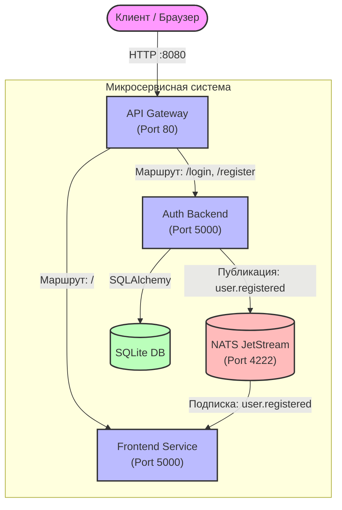
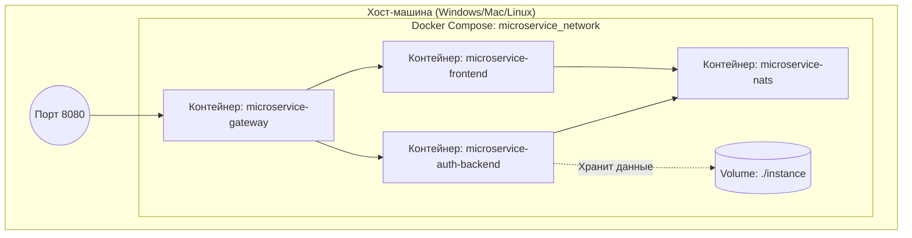

# 🏗 Архитектура проекта

Этот документ описывает общую структуру проекта, логическое и физическое взаимодействие компонентов.

## 📁 Структура проекта

```text
WebAPP/
├── docker-compose.yml       # Оркестрация контейнеров
├── README.md                # Главная страница документации
├── docs/                    # Данная папка с документацией
├── gateway/                 # API Gateway (точка входа)
│   ├── Dockerfile
│   └── gateway.py
├── frontend-service/        # Микросервис UI
│   ├── Dockerfile
│   └── app.py
└── flask-auth-service/      # Микросервис авторизации
    ├── app/
    │   ├── __init__.py      # Инициализация Flask и БД
    │   ├── events.py        # Публикация событий в NATS
    │   ├── models.py        # Модель User
    │   └── routes.py        # HTTP-маршруты
    ├── Dockerfile
    ├── requirements.txt
    └── run.py
```

## 🧩 Компонентная UML-диаграмма (Component Diagram)

Показывает логические блоки системы и направления их взаимодействия.



## 🐳 Диаграмма развертывания (Deployment UML)

Отражает физическое размещение контейнеров в Docker-сети и проброс портов.

