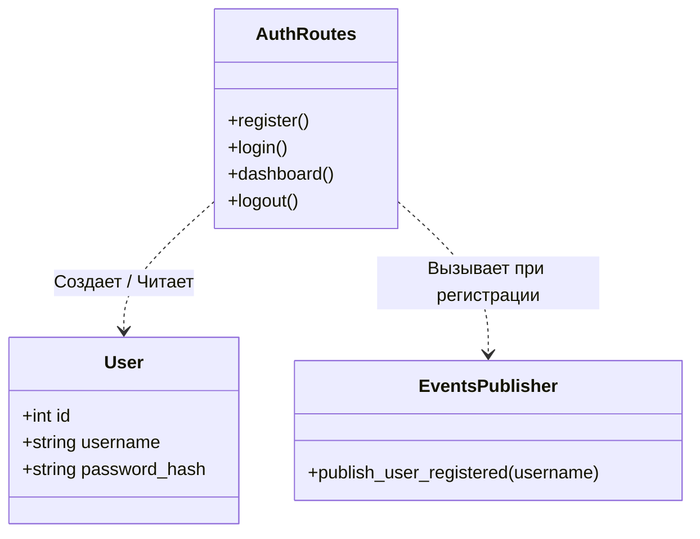
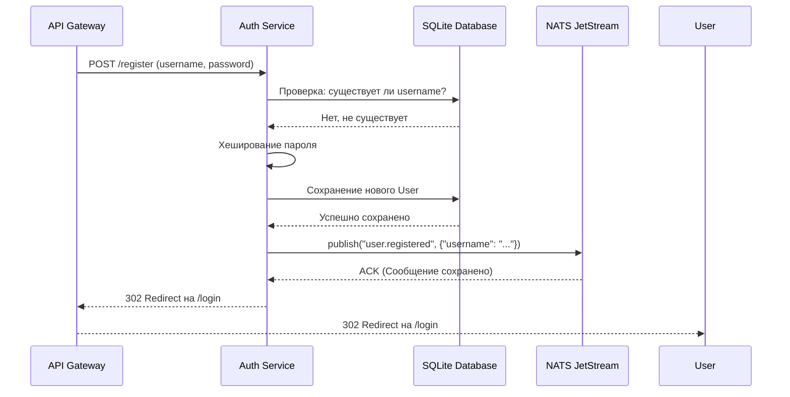

# 🔐 Auth Backend Service

## Описание
Микросервис, отвечающий за управление пользователями, безопасность и аутентификацию. Изолирован от внешнего мира (доступен только через Gateway и внутри Docker-сети).

## Ответственности
*   Регистрация новых пользователей (хеширование паролей через `werkzeug.security`).
*   Аутентификация (проверка паролей, создание сессий).
*   Хранение данных в SQLite (через Flask-SQLAlchemy).
*   Публикация события `user.registered` в брокер NATS JetStream после успешной регистрации.

## UML: Диаграмма классов (Class Diagram)

## UML: Диаграмма последовательности (Регистрация)

## 🛠 Технологический стек и стиль кода (Coding Style)

*   **Язык:** Python 3.11
*   **Фреймворк:** Flask 3.0.3
*   **Стиль кода:** 
    *   Строгое соблюдение **PEP 8**.
    *   Форматирование через `black`, линтинг через `ruff`.
    *   Функции и переменные: `snake_case`.
    *   Классы: `PascalCase`.
    *   Константы: `UPPER_SNAKE_CASE` (например, `NATS_URL`).
*   **Безопасность:** Хеширование паролей обязательно через `werkzeug.security`.

## ⚙️ Конфигурация

Сервис читает следующие переменные окружения:

| Переменная | Обязательная | По умолчанию | Описание |
| :--- | :---: | :--- | :--- |
| `SECRET_KEY` | Нет (обязательно в проде) | `dev-secret-key-change-me` | Ключ подписи сессий Flask-Login. В продакшене должен задаваться через окружение (`.env` / Docker), **не** храниться в коде. |
| `NATS_URL` | Нет | `nats://nats:4222` | Адрес брокера NATS JetStream. |