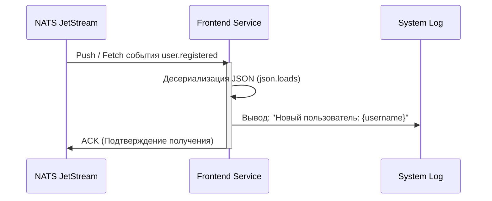

# 🎨 Frontend Service

## Описание
Микросервис, отвечающий за отображение пользовательского интерфейса (главной страницы). Также выполняет роль фонового обработчика событий (Subscriber).

## Ответственности
*   Отдача HTML-лендинга при запросе на корневой путь `/`.
*   Подписка на поток `USER_EVENTS` в NATS JetStream (с использованием Durable Consumer).
*   Обработка события `user.registered` (в текущей реализации — логирование, в будущем — отправка приветственных писем или создание профиля).

## UML: Диаграмма последовательности (Обработка события)

## 🛠 Технологический стек и стиль кода (Coding Style)

*   **Язык:** Python 3.11
*   **Фреймворк:** Flask 3.0.3 + `asyncio` (для фонового слушателя)
*   **Стиль кода:**
    *   Соблюдение **PEP 8**.
    *   Асинхронный код (`async def`) должен быть изолирован от синхронного кода Flask (запуск в отдельном потоке через `threading.Thread`).
    *   Функции и переменные: `snake_case`.
*   **Особенности:** Вся бизнес-логика (подписка на события) выполняется в фоновом режиме и не должна блокировать отдачу HTML-страниц пользователю.