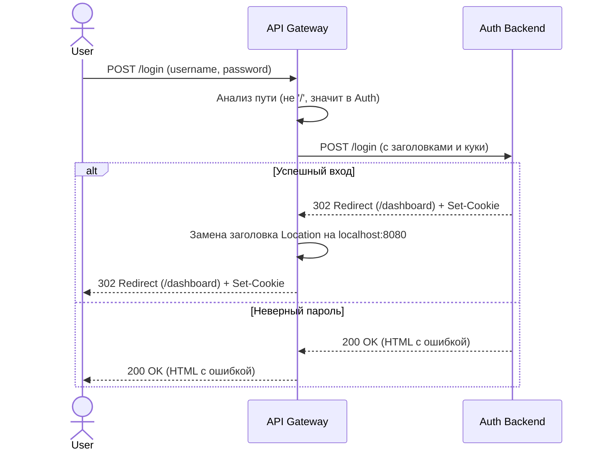

# 🚪 API Gateway

## Описание
Единственная точка входа в систему (Single Point of Entry). Скрывает внутреннюю структуру Docker-сети от клиента. Написан на Flask. Выполняет роль обратного прокси (Reverse Proxy) и маршрутизатора.

## Ответственности
*   Принимать все входящие HTTP-запросы на порту 80 (снаружи — 8080).
*   Маршрутизировать запросы на основе URL:
    *   `/` -> `http://frontend-service:5000`
    *   Все остальные пути -> `http://auth-backend:5000`
*   Пробрасывать заголовки (включая `Cookie` для сессий) и тело запроса.
*   Переписывать заголовки `Location` в ответах (редиректах), чтобы браузер не узнал внутренние IP-адреса контейнеров.

## UML: Диаграмма последовательности (Sequence Diagram)

Обработка запроса на авторизацию пользователя.

## 🛠 Технологический стек и стиль кода (Coding Style)

*   **Язык:** Python 3.11
*   **Фреймворк:** Flask 3.0.3 (используется как Reverse Proxy)
*   **Стиль кода:**
    *   Соблюдение **PEP 8**.
    *   Поскольку сервис небольшой, основной упор делается на обработку исключений (try/except) при сетевых запросах (`requests.exceptions.ConnectionError`).
    *   Функции и переменные: `snake_case`.
*   **Особенности:** Запрещено использовать тяжелые ORM или базы данных внутри шлюза. Шлюз должен оставаться максимально быстрым и "тонким".